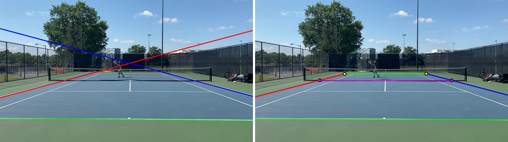
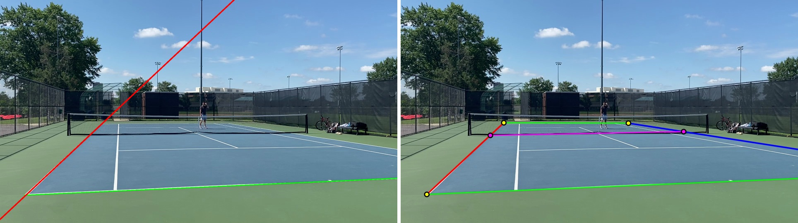

# RallyClip

RallyClip is an open-source tool for tennis video segmentation. It extracts rally/point intervals from full match footage and outputs a segmented video plus optional CSV timestamps.

The new macOS desktop app uses SwiftUI and AVFoundation for playback, editing,
and export. It bundles the v0.6 ONNX analysis engine, including the learned court
and net detector and separate near/far player features. Everything runs locally.
The original RallyClip logo stays; the interface uses native controls, the system
font, and the system light/dark appearance.

Native build, development, testing, and signing: [docs/native-macos.md](docs/native-macos.md).

## To run

**macOS with an M-series chip (M1, M2, M3, …)**

Install the desktop app from [GitHub Releases](https://github.com/iroblesrazzaq/RallyClip/releases).

Open the DMG and drag RallyClip into Applications. The native app requires macOS
14 or newer and Apple Silicon. Choose a video or a folder of consecutive MP4
clips; review points, save boundary edits, then export a video, selected
highlights, separate point videos, or CSV timestamps. Keep original footage
available for playback and full-quality export.

**Windows, Linux, and Intel Macs**

Install [uv](https://docs.astral.sh/uv/getting-started/installation/) if you do not have it (`brew install uv`, or the installer on that page). uv will create a local environment and can install Python 3.10+.

```bash
git clone --depth 1 --single-branch https://github.com/iroblesrazzaq/RallyClip.git
cd RallyClip
uv sync --extra cpu
uv run python scripts/fetch_artifact.py
uv run rallyclip gui
```

That starts a local backend and opens RallyClip in your browser at `http://127.0.0.1:8000` (or the next free port). Leave the terminal open while you use it.

NVIDIA GPU with CUDA:

```bash
uv sync --extra gpu
uv run rallyclip gui
```

Do not combine the `cpu` and `gpu` extras — they install conflicting ONNX Runtime wheels.

CLI, training, and extra install notes live in [`docs/ENVIRONMENT.md`](docs/ENVIRONMENT.md).

## Features coming soon (in rough order)
- improved court detector + model performance:
    - I switched the old heuristic CV court detector with a new deep learning model. Here's a case where the old detector did decently, and we can still see huge improvements from the new detector (old on the left, new on the right):

      

      Also, we have the net and the far baseline now, which is useful for filtering across multiple YOLO windows.

      The model can also handle more diagonal videos (likely an effect of including image rotations in our augmentation scheme). Here's a frame where the old detector would have failed, and the new one's detection is near perfect:

      
    - using a pretrained HRNet base (to maintain high resolution court line features)
    - objective: model outputs 5 heatmaps of 128x72 pixels, each with a line (near and far baselines, doubles sidelines, and the net line (bottom of the net).
          - the ground truth is the actual line segment where each target is exp(-d^2/2), where d is the distance from a given pixel to the nearest point on the line segment. This means that on the line segment, the target is about 1, and it goes to zero pretty fast as we move away from the line. Then, we do BCE over each pixel in our 5 output maps, weighting line pixels more heavily.
    - the super cool part is that I had opus 5.5 label a bunch of court images and it was scarily accurate (very few cases where human could do better). So I could automate my data labelling :). 
- iOS mobile app beta coming soon
- doubles support


## Current release status
The current public stable desktop release is `v0.5.0`. The native v0.6 desktop
is being prepared on `feat/native-macos`; this branch's release workflow builds,
signs, and notarizes it using the existing Apple credentials. The verified v0.6
[model artifact](https://github.com/iroblesrazzaq/RallyClip/releases/tag/artifact-rallyclip_v0.6.1)
is available for source and CI builds.

## Stuff I'm thinking about
Current non-user-facing features and long term ideas
- OPTIMIZE TF OUTTA THE MODELS TO MAKE THEM FASTER AND BETTER!!!! (always)
- Match scoring: seems pretty hard. Will need a rework of architecture to track way more stuff (need player identity, tracking who won point, which will require much more advanced arch and more data presumably)
- 4k support
- allow for files > 2Gb on desktop (web gui with local backend is fine) cuz i fixed memory issue so now we stream and dont load everything into memory lol

The next platform is iOS. The native desktop's media and point-timeline code is
isolated in `RallyClipKit`, while inference still uses the proven bundled Python
engine on macOS.
